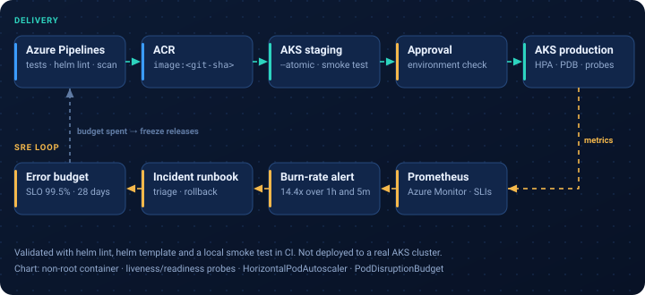

# Vamsikrishna Gollapudi - Portfolio

**Azure DevOps Engineer with SRE (Site Reliability Engineering) | Azure Infrastructure | Windows & Linux Administration**

Open to **fully remote roles only**, based in India.

- Live portfolio: https://gollapudivamsi18.github.io/
- GitHub profile: https://github.com/gollapudivamsi18

[](https://github.com/gollapudivamsi18/gollapudivamsi18.github.io/actions/workflows/validate.yml)

## About me
I'm an Azure DevOps Engineer and Site Reliability Engineer with 9+ years of IT experience. I began in Linux and Windows server administration and moved into Azure infrastructure, CI/CD pipelines, Kubernetes (AKS) and reliability engineering for life sciences, banking and asset-management clients.

## Independent portfolio demos
All five demos use fictional systems, synthetic data and original example files. They are not client work and contain no production configuration.

| Demo | What it shows | Experience area |
|---|---|---|
| [AKS + Helm delivery with SRE](demos/aks-helm-sre/) | Helm chart, CI checks, staged deployment with approval, SLO, burn-rate alerts, incident runbook | Healthcare and life sciences SRE |
| [Azure Pipelines for a Transaction API](demos/banking-pipeline/) | PR checks, Dev -> UAT -> Prod promotion, approval point, rollback, work items | Banking DevOps |
| [Terraform hub-and-spoke](demos/terraform-hub-spoke/) | Hub-and-spoke networking, tagging, backup, DR design, cost considerations | Financial services cloud infrastructure |
| [Windows and Linux migration plan](demos/migration-plan/) | Inventory, dependency map, wave planner, cutover checks, rollback runbook | Life sciences migration |
| [Patching and OS upgrade lab](demos/patching-lab/) | PowerShell and Bash pre/post-checks, patching, compliance report | Windows and Linux administration |



## How this repository is tested
The [Validate demos](.github/workflows/validate.yml) workflow runs on every push using free GitHub Actions:
Python unit tests, YAML parsing, `helm lint`, a local smoke test of the demo API, `terraform fmt` and `terraform validate`, ShellCheck, and PSScriptAnalyzer.

Anything that needs a paid Azure subscription (AKS, ACR, backup vaults, Azure Migrate) is described in each demo's README but is not created here.

## Repository layout
```
index.html            portfolio site (GitHub Pages)
resume.html           view-only resume page
assets/img/           diagrams and illustrations (SVG)
demos/<name>/         one folder per demo, each with its own README
.github/workflows/    CI checks
```

## Contact
Email: Gollapudi.vamsi18@gmail.com
