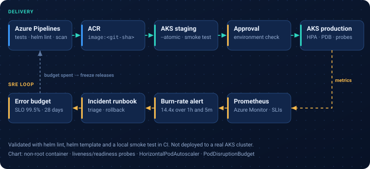
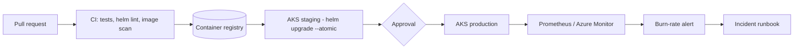
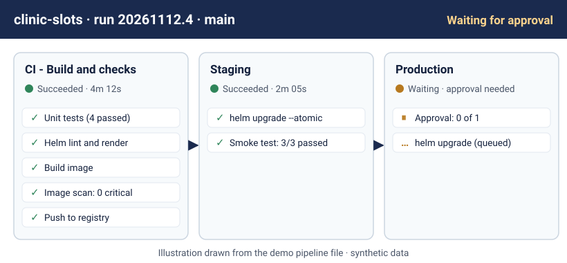
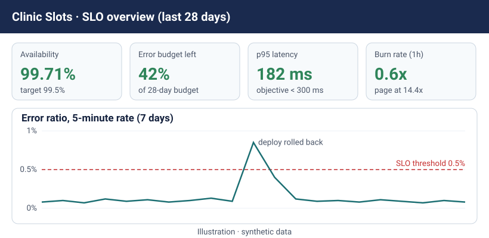

# AKS + Helm delivery with SRE practices

> **Independent portfolio demo.** Fictional service ("Clinic Slots API"), synthetic data and original example files. No client assets or production configuration.

**Related experience area:** healthcare and life sciences SRE.

## What this demonstrates
- A small containerised API packaged as a Helm chart for AKS (probes, non-root user, HPA, PodDisruptionBudget).
- An Azure Pipelines YAML workflow with pull-request checks (unit tests, `helm lint`, image scan), a staging deployment and a production stage protected by an environment approval.
- An example **SLO** (99.5% availability over 28 days) with multi-window burn-rate alerts.
- A monitoring view and an **incident runbook** that an on-call engineer can follow.

## Architecture





Sample pipeline run and monitoring view (illustrations drawn from the demo files, synthetic data):




## Files
| Path | Purpose |
|---|---|
| [app/app.py](app/app.py) | Standard-library Python API with `/healthz`, `/api/slots`, `/metrics` |
| [app/test_app.py](app/test_app.py) | Unit tests |
| [app/Dockerfile](app/Dockerfile) | Non-root container image |
| [chart/clinic-slots/](chart/clinic-slots/) | Helm chart: Deployment, Service, HPA, PDB, prod overrides |
| [azure-pipelines.yml](azure-pipelines.yml) | Multi-stage pipeline: CI, staging, approved production |
| [sre/slo.yaml](sre/slo.yaml) | Example SLO and error-budget policy |
| [sre/prometheus-rules.yaml](sre/prometheus-rules.yaml) | Recording rules and burn-rate alerts |
| [sre/incident-runbook.md](sre/incident-runbook.md) | Step-by-step incident runbook |
| [sre/smoke-test.sh](sre/smoke-test.sh) | Post-deployment smoke test |

## Run and validate locally (free)
```bash
cd demos/aks-helm-sre/app
python3 -m unittest -v                # unit tests
python3 app.py &                      # start on :8080
bash ../sre/smoke-test.sh http://localhost:8080
helm lint ../chart/clinic-slots       # needs Helm 3
helm template demo ../chart/clinic-slots -f ../chart/clinic-slots/values-prod.yaml
```
Optional: install the chart on a local cluster (kind or minikube) after building the image locally.

These checks also run on every push through the repository's free GitHub Actions workflow.

## Needs an Azure environment (out of scope here)
- AKS cluster, Azure Container Registry and the two service connections named in the pipeline.
- Azure DevOps environments `clinic-slots-staging` and `clinic-slots-prod` with an approval check on prod.
- Prometheus (or Azure Managed Prometheus) and Grafana to load the alert rules.

No paid Azure resources are created by this repository.
