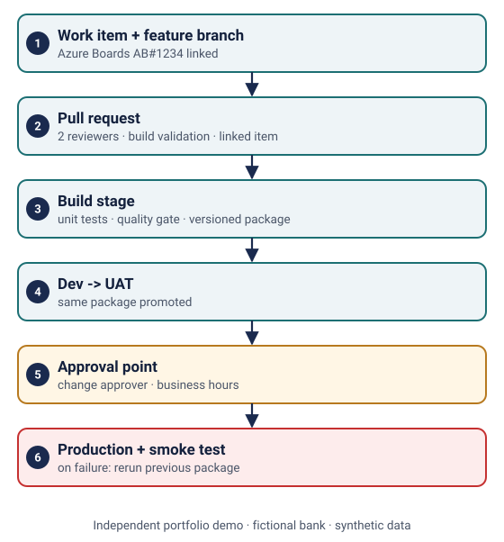
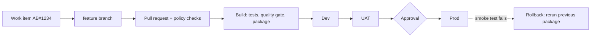

# Azure Pipelines YAML workflow for a sample Transaction API

> **Independent portfolio demo.** Fictional bank and accounts, synthetic data and original example files. No client assets or production configuration.

**Related experience area:** banking DevOps.

## What this demonstrates
- **Pull-request checks:** unit tests, syntax check and a quality-gate step run on every PR.
- **Staged promotion:** one versioned package moves Dev -> UAT -> Prod; production gets exactly what UAT tested.
- **Approval point:** the `txn-api-prod` environment has an approval and business-hours check.
- **Rollback:** a documented path to the last good version in under 15 minutes.
- Azure DevOps fundamentals: branch policies, Git pull requests and work-item linking ([docs/branch-policy.md](docs/branch-policy.md)).
- Idempotent transfer logic, so a retried request never debits twice.

## Workflow





## Files
| Path | Purpose |
|---|---|
| [src/transaction_api.py](src/transaction_api.py) | Transfer validation with limits and idempotency keys |
| [tests/test_transaction_api.py](tests/test_transaction_api.py) | Unit tests |
| [azure-pipelines.yml](azure-pipelines.yml) | Multi-stage pipeline with PR trigger and conditions |
| [templates/deploy.yml](templates/deploy.yml) | Reusable deployment job with rollback hook |
| [docs/branch-policy.md](docs/branch-policy.md) | Branch policy, PR checklist, work-item flow |
| [docs/rollback.md](docs/rollback.md) | Rollback instructions |

## Run and validate locally (free)
```bash
python3 -m unittest discover -s demos/banking-pipeline/tests -v
```
The same tests run in the repository's GitHub Actions workflow.

## Needs an Azure DevOps organisation (out of scope here)
- Import the YAML into Azure Pipelines, create environments `txn-api-dev`, `txn-api-uat`, `txn-api-prod`, and add an **Approvals** check on prod.
- Apply the branch policy on `main` as described in the docs.
- Real deployment targets (App Service, AKS or VMs) replace the `echo` demo steps.
