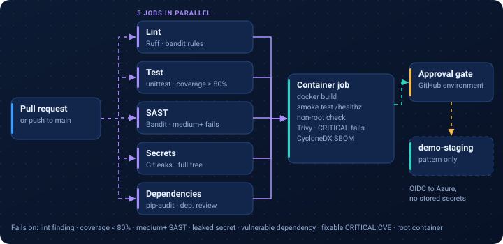

# GitHub Actions DevSecOps pipeline

> Independent portfolio demo. The inventory service is fictional. The pipeline runs on
> free GitHub-hosted runners; nothing is deployed to a cloud account.

A pull-request pipeline that checks code, dependencies, secrets and the container image
before anything can move toward an environment. The workflow is
[`.github/workflows/devsecops-demo.yml`](../../.github/workflows/devsecops-demo.yml).



## Pipeline stages

| Job | Tool | Fails the build when |
| --- | --- | --- |
| lint | Ruff (pycodestyle, pyflakes, bugbear, bandit rules) | any finding |
| test | unittest + coverage | a test fails or coverage < 80% |
| sast | Bandit | medium or high severity issue |
| secrets | Gitleaks | a secret pattern is found in the tree |
| dependencies | pip-audit, GitHub dependency review (PRs) | a known vulnerable dependency |
| container | docker build, smoke test, Trivy, CycloneDX SBOM | container fails health check, runs as root, or has a fixable CRITICAL CVE |
| deploy-example | GitHub environment `demo-staging` | manual run on `main` only; prints what it would deploy |

The first five jobs run in parallel; the container job waits for all of them.
Image and SBOM are stored as build artifacts for 7 days.

## The service
`app/inventory_api.py` — list items, view one, reserve stock. It validates the SKU format
and request body (JSON, integer 1–100, max 1 KB) and returns JSON errors with sensible
status codes (400, 404, 405, 409, 413). Standard library only.

## Run locally
```bash
cd app
python3 -m unittest -v          # 8 tests, including real HTTP calls
python3 inventory_api.py        # http://localhost:8080/api/items
curl -X POST localhost:8080/api/items/KBD-1001/reserve -d '{"quantity": 2}'

docker build -t inventory-api app/
docker run --rm -p 8080:8080 inventory-api
```

## Testing evidence
- Unit and HTTP tests: run locally on 13 Nov 2026 — 8 tests pass.
- Ruff, Bandit, Gitleaks, pip-audit, Trivy: run in GitHub Actions on each change to this folder.
  Results are on the repository's Actions tab.

## Security notes
See [docs/deployment.md](docs/deployment.md): OIDC federated credentials instead of stored
secrets, least-privilege workflow permissions, environment approvals, and image promotion
by digest.

## Troubleshooting
| Symptom | Likely cause |
| --- | --- |
| Trivy gate fails | Base image has a newly published fixable CVE. Rebuild on the latest `python:3.12-slim` or pin a patched tag. |
| Gitleaks fails on a test fixture | Add the path to a `.gitleaksignore` with a comment explaining why it is safe. |
| Coverage gate fails | New code without tests; add tests rather than lowering the threshold. |

## Limitations
- No registry push or real deployment (no cloud subscription behind the demo).
- Actions are pinned to release tags, not commit SHAs.
- Single language (Python). A real monorepo would add language-specific scanners.

## Possible next steps
- CodeQL analysis and SARIF upload to GitHub code scanning.
- Sign images with cosign and verify the signature before deploy.
- Real staging deployment to AKS using the OIDC pattern in `docs/deployment.md`.
