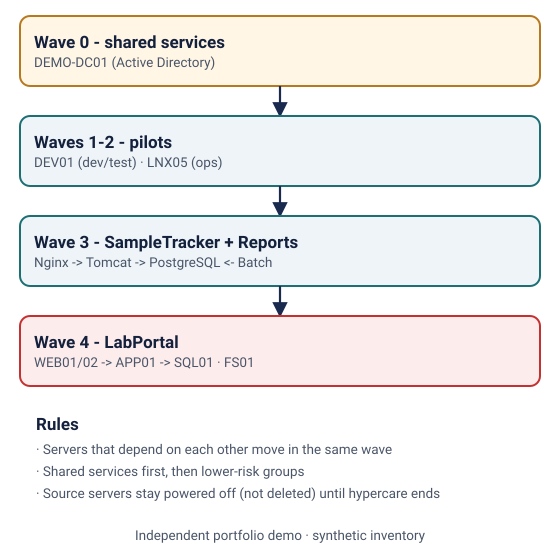
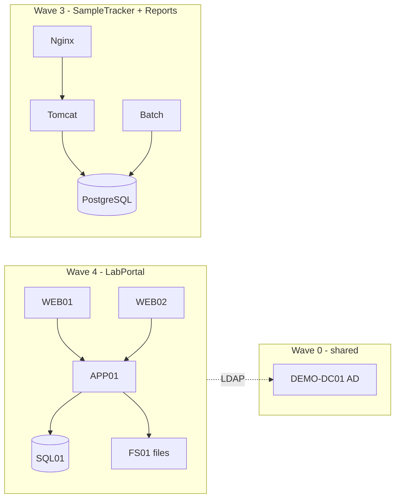

# Windows and Linux migration plan to Azure

> **Independent portfolio demo.** Fictional applications ("LabPortal", "SampleTracker"), synthetic inventory and original example files. No client assets or production configuration.

**Related experience area:** life sciences migration.

## What this demonstrates
- A **sample inventory** of 12 Windows and Linux servers with sizing and criticality.
- A **dependency map** (who talks to whom, on which port).
- A small script that turns the inventory into **migration waves**: dependent servers move together, shared services go first, and lower-risk groups go before critical ones.
- **Cutover checks** for Windows, Linux, Azure and the application, plus a **rollback runbook** with a clear decision rule.

## Dependency map and waves





Full generated plan: [waves.md](waves.md).

## Files
| Path | Purpose |
|---|---|
| [inventory/servers.csv](inventory/servers.csv) | Sample server inventory (synthetic) |
| [inventory/dependencies.csv](inventory/dependencies.csv) | Dependency map with ports |
| [scripts/plan_waves.py](scripts/plan_waves.py) | Validates inputs and groups servers into waves |
| [scripts/test_plan_waves.py](scripts/test_plan_waves.py) | Unit tests (every server placed once, dependencies kept together) |
| [waves.md](waves.md) | Generated wave plan |
| [runbooks/cutover-checklist.md](runbooks/cutover-checklist.md) | T-5, cutover and post-migration checks |
| [runbooks/rollback-runbook.md](runbooks/rollback-runbook.md) | Rollback decision rule and steps |

## Run and validate locally (free)
```bash
cd demos/migration-plan
python3 scripts/plan_waves.py inventory/servers.csv inventory/dependencies.csv > waves.md
cd scripts && python3 -m unittest -v
```

## Needs an Azure environment (out of scope here)
Discovery and replication use Azure Migrate (appliance on-premises) and Azure Site Recovery or the Migrate replication service; test migrations and cutovers create billable Azure VMs.
