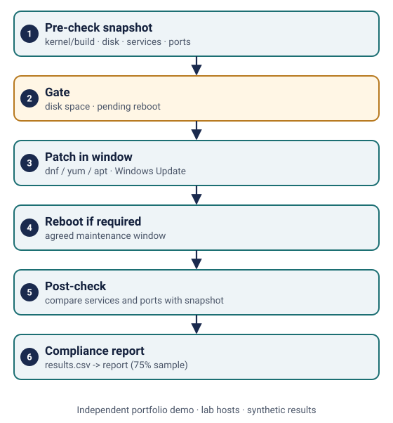
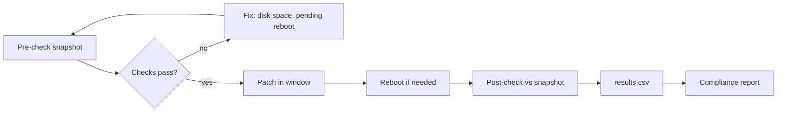

# Patching and OS upgrade lab (PowerShell and Bash)

> **Independent portfolio demo.** Lab hosts and results are synthetic; scripts are original examples. No client assets or production configuration.

**Related experience area:** Windows and Linux administration.

## What this demonstrates
- **Pre-checks** that capture a snapshot before patching: OS and kernel/build, free space, running services, listening ports, pending reboot.
- **Patching** for RHEL (dnf/yum) and Ubuntu (apt) with `--security-only` and `--dry-run` options.
- **Post-checks** that compare with the snapshot and flag services or ports that did not come back.
- An example **patch compliance report** built from the post-check results.
- An **OS upgrade checklist** for Windows Server, RHEL (Leapp) and Ubuntu LTS.

## Workflow





## Files
| Path | Purpose |
|---|---|
| [linux/precheck.sh](linux/precheck.sh) | Snapshot and blocking checks (disk, /boot) |
| [linux/patch.sh](linux/patch.sh) | dnf/yum/apt updates with dry-run |
| [linux/postcheck.sh](linux/postcheck.sh) | Compare services, ports, failed units; append to results.csv |
| [windows/Invoke-PreCheck.ps1](windows/Invoke-PreCheck.ps1) | JSON snapshot, free space and pending-reboot checks |
| [windows/Invoke-PostCheck.ps1](windows/Invoke-PostCheck.ps1) | Service and event-log checks; append to results.csv |
| [report/build_report.py](report/build_report.py) | Builds the compliance report |
| [report/sample-compliance-report.md](report/sample-compliance-report.md) | Example output (75% compliant, 2 hosts flagged) |
| [docs/os-upgrade-checklist.md](docs/os-upgrade-checklist.md) | In-place upgrade steps and rollback |

## Run and validate locally (free)
```bash
cd demos/patching-lab
bash linux/precheck.sh /tmp/patchlab        # safe, read-only apart from the snapshot file
bash linux/patch.sh --dry-run               # prints the commands only
bash linux/postcheck.sh /tmp/patchlab
cd report && python3 build_report.py sample-results.csv && python3 -m unittest -v
```
On Windows (PowerShell 5.1 or 7, as Administrator): `.\windows\Invoke-PreCheck.ps1 -OutputPath C:\PatchLab`.

ShellCheck, PSScriptAnalyzer and the report tests run in the repository's GitHub Actions workflow.

## Needs real servers or VMs
Actual patching and reboots need lab VMs (local Hyper-V/VirtualBox, or Azure VMs with Azure Update Manager, which is billable and out of scope here). Do not run `patch.sh` without `--dry-run` on a machine you care about.
