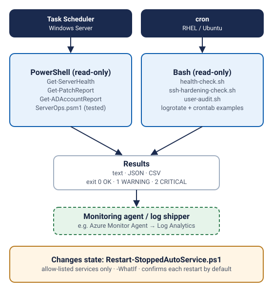

# Windows and Linux server operations toolkit

> Independent portfolio demo. Scripts are original examples written for this portfolio.
> They were tested against fixture files and in CI, not against any employer's servers.

Day-to-day checks I would want on any fleet: is the box healthy, is it patched, who can
log in, is SSH locked down, did a service stop. Everything that only reads is safe to
run anywhere; the one script that changes state asks before acting.



## Windows Server (PowerShell 5.1+ / 7)

| Script | Changes system? | Purpose |
| --- | --- | --- |
| `windows/Get-ServerHealth.ps1` | No | CPU, memory, fixed disks, stopped automatic services, System error/critical events. Multiple servers via CIM; JSON output; exit 0/1/2. |
| `windows/Get-PatchReport.ps1` | No | Last hotfix, days since patching, pending reboot, compliance flag per server. |
| `windows/Get-ADAccountReport.ps1` | No | Stale enabled accounts, locked-out accounts, "password never expires". CSV per finding. Needs RSAT ActiveDirectory module. |
| `windows/Restart-StoppedAutoService.ps1` | **Yes** | Restarts stopped automatic services **only from an allow-list**. `-WhatIf` supported; confirms each restart by default; logs every action. |
| `windows/ServerOps.psm1` | No | Shared, platform-independent helpers (thresholds, worst state, stale-account filter, logging). |

```powershell
.\Get-ServerHealth.ps1 -ComputerName SRV01,SRV02 -AsJson
.\Get-PatchReport.ps1 -ComputerName (Get-Content servers.txt) | Export-Csv patch.csv -NoTypeInformation
.\Restart-StoppedAutoService.ps1 -AllowList W3SVC,Spooler -WhatIf
```

## Linux (RHEL / Ubuntu, Bash 4+)

| Script | Changes system? | Purpose |
| --- | --- | --- |
| `linux/health-check.sh` | No | Load per core, memory (MemAvailable), disk per filesystem, failed systemd units. Text or JSON; exit 0/1/2. |
| `linux/ssh-hardening-check.sh` | No | Compares sshd settings to a baseline (root login, password auth, MaxAuthTries, idle timeout). Uses `sshd -T` when root. |
| `linux/user-audit.sh` | No | Interactive users, sudo/wheel membership, empty or locked passwords. |
| `linux/logrotate-app.conf` | — | Example logrotate policy for an application log. |
| `linux/crontab.example` | — | How the checks are scheduled. |

```bash
bash linux/health-check.sh --json --disk-warn 75
bash linux/ssh-hardening-check.sh /etc/ssh/sshd_config
sudo bash linux/user-audit.sh
```

## Testing evidence
- Linux scripts: `python3 -m unittest discover -s demos/server-ops-toolkit/tests -v` runs each
  script against fixture files (fake `/proc`, sshd configs, passwd/shadow/group).
  7 tests pass locally (13 Nov 2026).
- PowerShell: `tests/ServerOps.Tests.ps1` (Pester 5) covers the shared module. It runs in CI on
  Linux with PowerShell 7, together with PSScriptAnalyzer. The CIM, event-log and AD calls
  need a real Windows Server and were not run in CI.
- ShellCheck runs on all Bash scripts in CI.

## Security notes
- Read-only by default. The single state-changing script uses `SupportsShouldProcess` with
  `ConfirmImpact = 'High'` and an explicit allow-list.
- No credentials in scripts; remote calls use the current Kerberos identity (CIM / WinRM).
- `user-audit.sh` prints whether a password is set, never the hash.

## Troubleshooting
| Symptom | Fix |
| --- | --- |
| `New-CimSession` fails | WinRM not enabled or firewall blocks 5985; run `Enable-PSRemoting` on the target. |
| `Get-ADAccountReport` cannot import module | Install RSAT: `Install-WindowsFeature RSAT-AD-PowerShell`. |
| Password column shows `n/a` | Run `user-audit.sh` as root to read `/etc/shadow`. |
| systemd check skipped | Running in a container; systemd is not PID 1. |

## Limitations
- No central collection; output is meant for a scheduler, a log shipper, or a monitoring agent.
- The SSH baseline is a short list, not a full CIS benchmark.

## Possible next steps
- Send JSON results to Azure Monitor Logs (Log Analytics) through the Azure Monitor Agent.
- Package the Windows scripts as a module with Azure Automation runbooks.
