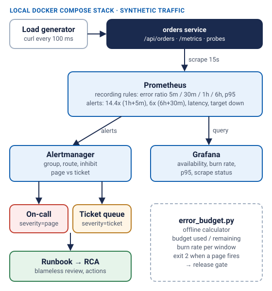

# SRE observability and incident management

> Independent portfolio demo. The service, traffic and incident are fictional and synthetic.
> Nothing here runs in Azure; the stack runs locally with Docker Compose.

This demo shows how I set up SLO-based monitoring for a service: define the SLI,
alert on error-budget burn rather than raw error spikes, route pages and tickets
differently, and close the loop with a runbook and a blameless review.



## What is in it

| Path | What it does |
| --- | --- |
| `app/orders_service.py` | Small HTTP service exposing Prometheus counters and a latency histogram. Error and latency injection via env vars. |
| `prometheus/rules/orders-slo.rules.yml` | Recording rules (error ratio over 5m/30m/1h/6h, p95) and multi-window burn-rate alerts. |
| `prometheus/rules/orders-slo.rules.test.yml` | `promtool` unit tests for the alerts. |
| `alertmanager/alertmanager.yml` | Pages vs tickets, grouping, and an inhibit rule so "target down" suppresses burn-rate noise. |
| `grafana/` | Provisioned data source and a dashboard: availability, burn rate, p95, scrape status. |
| `slo/error_budget.py` | Offline calculator: availability, budget used/remaining, and which burn-rate alerts would fire. |
| `data/generate.py` | Deterministic synthetic traffic (3 days, then an ongoing incident). The CSV is generated, not committed. |
| `runbooks/` | Error-budget burn and latency runbooks. |
| `incidents/` | A fictional RCA and a reusable template. |

## SLI and SLO
- **SLI:** share of `/api/orders` requests that do not return 5xx.
- **SLO:** 99.5% over 30 days → allowed error ratio 0.5%.
- **Alerting:**

| Severity | Long window | Short window | Burn rate | Budget spent if sustained |
| --- | --- | --- | --- | --- |
| page | 1h | 5m | 14.4x | 2% per hour |
| page | 6h | 30m | 6x | 5% per 6 hours |
| ticket | 3d | 6h | 1x | 10% per 3 days |

Requiring both windows means a page stops quickly once errors stop (the short window clears),
and a brief spike does not page (the long window has not moved).

## Run it

### Error-budget calculator (Python 3.10+, no dependencies)
```bash
python3 data/generate.py > data/sample-requests.csv   # deterministic, seed 42
cd slo
python3 error_budget.py ../data/sample-requests.csv --slo 99.5
python3 -m unittest -v
```
Output on the sample data:
```
Availability:      99.763%
Error budget:      12520.3 failed requests allowed
Budget used:       47.4%  (remaining 52.6%)
ALERT [page] burn 34.0x over 1:00:00 and 51.73x over 0:05:00 (threshold 14.4x)
```
The script exits with code 2 when a page-level alert fires, so it can gate a release pipeline.

### Full stack (Docker)
```bash
docker compose up -d
# make it fail: edit ERROR_RATE to 0.2 in docker-compose.yml, then
docker compose up -d orders
docker compose logs -f webhook-sink   # alert notifications appear here
```

### Alert rule tests
```bash
docker run --rm -v "$PWD/prometheus/rules:/rules" --entrypoint promtool \
  prom/prometheus:v2.55.1 test rules /rules/orders-slo.rules.test.yml
```

## Testing evidence
- Python tests (`slo/`, `app/`): run locally on 13 Nov 2026 — 11 tests pass.
- `promtool check` and `promtool test rules`: run in GitHub Actions (`Validate demos` workflow).
- Docker Compose stack: not run in the authoring environment (no image registry access).
  The compose file is syntax-checked in CI.

## Security notes
- Grafana anonymous access is **viewer only** and meant for local use.
- The service runs as a non-root user in the container.
- Webhook receivers point at a local sink; no external endpoints or keys.

## Troubleshooting
| Symptom | Check |
| --- | --- |
| Dashboard empty | `http://localhost:9090/targets` — is `orders` UP? |
| Alerts never fire | Raise `ERROR_RATE`; fast burn needs ~7% errors for 2 minutes. |
| Recording rules show NaN | No traffic yet — the load generator needs a minute. |

## Limitations
- Single service, single SLI. Real setups add latency SLOs and per-customer views.
- The 30-day budget query needs 30 days of data; the demo shows short-window behaviour.
- No long-term storage (Thanos/Mimir) or Azure Monitor managed Prometheus.

## Possible next steps
- Send metrics to Azure Monitor managed service for Prometheus and Azure Managed Grafana.
- Add a latency SLO with its own burn-rate alerts.
- Wire the calculator into the AKS demo's release pipeline as a promotion gate.
