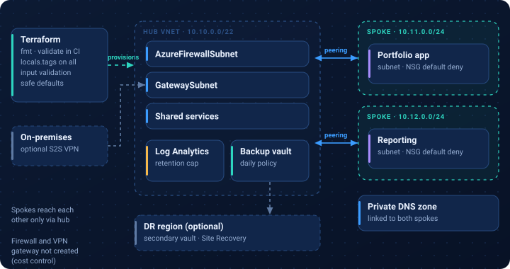
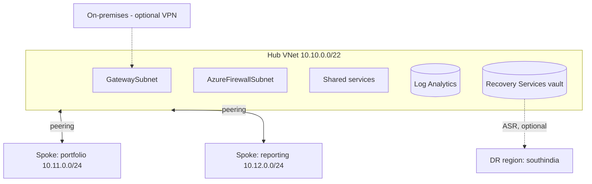

# Terraform hub-and-spoke environment for asset management

> **Independent portfolio demo.** Fictional asset-management platform, original example files. No client assets or production configuration.

**Related experience area:** financial services cloud infrastructure.

## What this demonstrates
- **Hub-and-spoke networking:** hub VNet with firewall, gateway and shared-services subnets; two spokes peered only with the hub; NSGs with default deny; private DNS zone linked to spokes.
- **Tagging:** one `locals.tags` block applied to every resource (application, environment, owner, cost centre, data class).
- **Backup and DR:** Recovery Services vault with a daily policy, optional secondary-region vault for Azure Site Recovery, example RTO/RPO table.
- **Cost considerations:** retention and ingestion caps, redundancy choices, optional DR ([docs/dr-and-cost.md](docs/dr-and-cost.md)).

## Architecture





## Files
| Path | Purpose |
|---|---|
| [main.tf](main.tf) | Provider, standard tags, resource groups, Log Analytics |
| [network.tf](network.tf) | Hub, spokes, subnets, NSGs, peering, private DNS |
| [backup.tf](backup.tf) | Backup vault and policy, optional DR vault |
| [variables.tf](variables.tf) | Inputs with validation and safe defaults |
| [outputs.tf](outputs.tf) | Useful IDs and the tag set |
| [terraform.tfvars.example](terraform.tfvars.example) | Example values |
| [docs/dr-and-cost.md](docs/dr-and-cost.md) | DR design, recovery targets and cost levers |

## Validate locally (free, no Azure login needed)
```bash
cd demos/terraform-hub-spoke
terraform fmt -check -recursive
terraform init -backend=false
terraform validate
```
These steps run in the repository's GitHub Actions workflow on every push.

## Needs an Azure subscription (out of scope here)
`terraform plan` and `apply` need an Azure login and create billable resources (Log Analytics, backup vaults). The paid firewall and VPN gateway are intentionally not created. Run `terraform destroy` after any trial.
